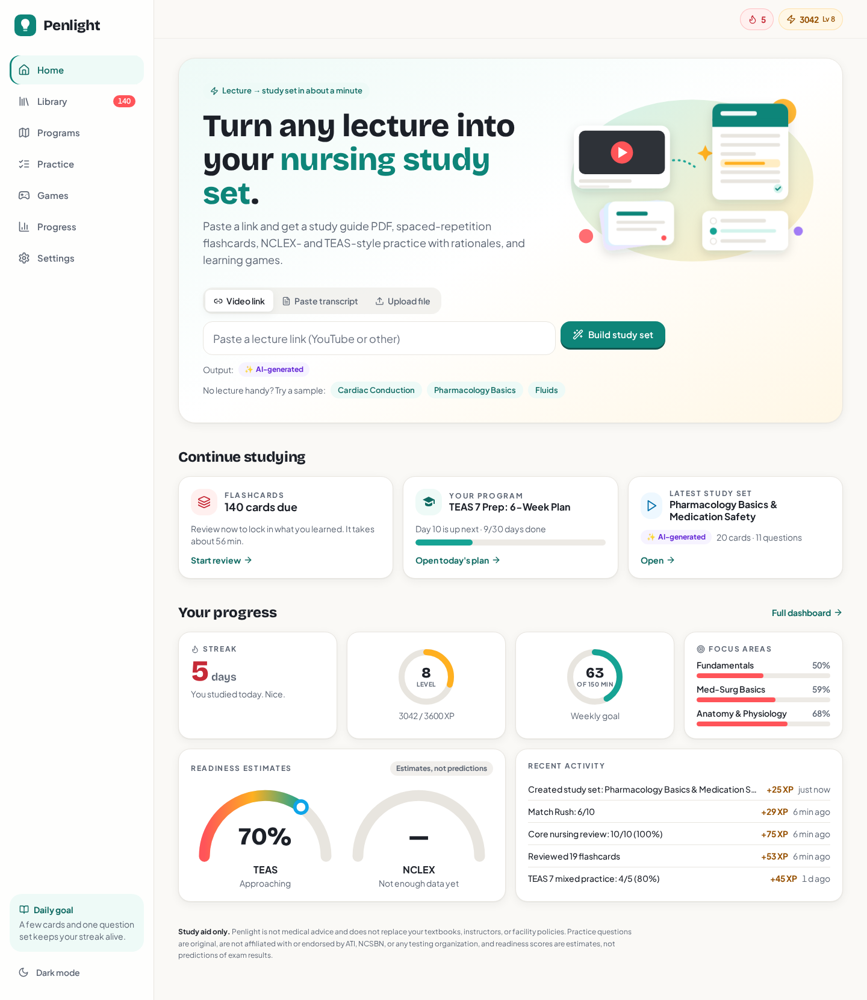

# Penlight — a study assistant for aspiring nurses (TEAS & NCLEX)

Paste a lecture link (YouTube or anything yt-dlp supports) or a transcript. Penlight pulls out the content and turns it into a
study guide (in-app + premium PDF), spaced-repetition flashcards, practice tests and learning games, then tracks your progress
toward the TEAS 7 and NCLEX-RN with premade study programs.

[](https://render.com/deploy?repo=https://github.com/JustUseFlint/penlight)



> **Study aid only.** Penlight is exam-prep support. It is not clinical guidance, not medical advice, and its readiness gauges are
> estimates, not predictors. Content was self-reviewed (see `docs/medical-review.md`) but has **not** been reviewed by a licensed clinician.

## Deploy it (free, no credit card)

**Recommended: Render free web service** (verified against Render's docs, October 2026): public `https://<name>.onrender.com` URL, no card, Docker runtime.

1. Click **Deploy to Render** above (or Render dashboard → *New → Blueprint* → this repo). Sign in with GitHub.
2. When asked for `PERSIST_DATABASE_URL`, paste a free Postgres URL (see below). `APP_SECRET` is generated for you.
3. Wait for the first build (about 10 to 15 minutes), then open the URL. `https://<name>.onrender.com/api/health` should say `{"ok":true}`.

**Why a Postgres URL?** Render's free disk is ephemeral and the instance spins down after 15 minutes idle, which would erase the SQLite file
(accounts, progress, saved study sets). Penlight keeps using plain SQLite, and `scripts/start.mjs` snapshots the file to Postgres every
30 seconds when it changes (and on shutdown) and restores it on boot. Create a free database at <https://console.neon.tech> (Neon free plan: no card; the database sleeps when idle, which is fine) or use a free Supabase Postgres, and paste its `postgres://…` connection string.
Without it the app still runs, but data resets on every spin-down.

**Free-tier realities (read these):**
- **Cold start:** after 15 minutes without traffic the instance sleeps; the next visit takes about a minute to wake.
- **512 MB RAM / 0.1 CPU:** PDF export uses Chromium in a one-at-a-time low-memory mode; if it ever runs out of memory the app falls back to a print-ready
  page ("Save as PDF" in your browser). Whisper (audio transcription) is disabled on the free host.
- **YouTube may block the host's datacenter IP** ("Sign in to confirm you're not a bot"). Pasting a transcript or uploading `.txt/.srt/.vtt` always works.
  Optional workaround: set `YTDLP_COOKIES_B64` to a base64 `cookies.txt` from a **throwaway** Google account.
- 750 free instance hours per month per Render workspace.

Other hosts: any Docker host works (`docker build -t penlight . && docker run -p 3100:3100 -e APP_SECRET=$(openssl rand -hex 32) -v penlight-data:/app/data penlight`).
Hugging Face Docker Spaces now require a paid PRO plan; see `docs/DEPLOY.md` for the full comparison.

## Quick start

```bash
npm install
npm run build
PORT=3100 npm start            # http://localhost:3100 (runs scripts/start.mjs)
```

Optional (video fallback when a video has no captions):

```bash
npm run setup:python           # creates .venv with yt-dlp, youtube-transcript-api, faster-whisper
sudo apt-get install ffmpeg    # needed for audio transcription
```

Development: `npm run dev` (port 3100). Tests: `npm test` (vitest), `node scripts/e2e-api.mjs`, `node scripts/e2e-ui.mjs`
(both need a production build and use throwaway databases).

## Modes: Lite and AI

Penlight works fully offline in **Lite mode** (extractive summarizer, glossary of ~1,000 nursing terms, rule-based question and
card generation). Every generated item is labeled **Lite** or **AI**. To turn on **AI mode**, set a key either in
**Settings** (stored server-side, AES-256-GCM encrypted, never sent to the browser) or via environment variables:

| Variable | Meaning |
|---|---|
| `LLM_PROVIDER` | `xai` (default base `https://api.x.ai/v1`), `openai`, `anthropic`, or `custom` (any OpenAI-compatible server) |
| `LLM_API_KEY` | your key (no key is bundled; none is ever required) |
| `LLM_MODEL` | model id (provider default if empty) |
| `LLM_BASE_URL` | override the endpoint |

AI output is schema-validated (zod), gets one repair retry, drops invalid questions, and falls back to Lite if the provider is
unreachable. `scripts/mock-llm.mjs` is a local OpenAI-compatible mock used to test this path without a key.

## Other environment variables

| Variable | Default | Purpose |
|---|---|---|
| `PORT` | 3100 | HTTP port for `npm start` |
| `DATA_DIR` / `DB_FILE` | `./data` | SQLite database, PDF cache, encryption secret |
| `YTDLP_COOKIES` | – | path to a cookies.txt; use when YouTube blocks your server's IP with a bot check |
| `DISABLE_WHISPER` | – | `1` disables the audio-transcription fallback |
| `WHISPER_MODEL` | `base` | faster-whisper model size (`tiny`…`large-v3`) |
| `PYTHON_BIN` | `.venv/bin/python` | python used for the ingestion worker |
| `ALLOW_TIME_TRAVEL` | – | `1` enables `POST /api/dev/time {days}` (testing only; never in production) |

## Architecture

- **Next.js 15 (App Router) + React 19 + Tailwind**, fonts bundled via `@fontsource-variable` (no CDN).
- **SQLite** (`better-sqlite3`): users (guest profile or email+password with argon2), lectures, decks/cards (SM-2), questions, attempts, games, programs, activity, XP.
- **Ingestion** (`src/lib/ingest`, `worker/ingest.py`): URL parsing → captions (youtube-transcript-api, then yt-dlp subtitles) → optional faster-whisper audio transcription. Paste/upload `.txt/.srt/.vtt` always works. Jobs run in-process and the UI polls progress.
- **Engines** (`src/lib/lite`, `src/lib/ai-engine.ts`): Lite and AI produce the same `Guide` shape.
- **PDF**: Playwright renders HTML → PDF, `pdf-lib` merges cover + body and adds page footers.
- **Content** (`content/*.md`): 319 vetted questions, 361 flashcards, 90 lessons, plus generated dosage drills; 8 programs.

## Limitations

- YouTube frequently bot-blocks datacenter IPs. If so, Penlight shows a clear message; supply `YTDLP_COOKIES`, run from a residential network, or paste the transcript.
- Whisper transcription on CPU is slow (minutes per hour of audio with `base`).
- Lite summaries are heuristic and work best on clean, structured lectures; AI mode is stronger but needs your own key.
- Readiness gauges are estimates built from your own practice data.

## Docker

```bash
docker build -t penlight .
docker run -p 3100:3100 -v penlight-data:/app/data penlight
```
